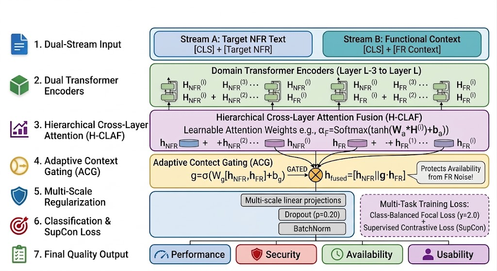

# Dual-Stream Adaptive Gated Network with Hierarchical Cross-Layer Aggregation for Context-Aware Non-Functional Requirement Classification

[](https://www.python.org/downloads/)
[](https://pytorch.org/)
[](https://opensource.org/licenses/MIT)
[](https://doi.org/)

Official PyTorch implementation of the research paper:  
**"Dual-Stream Adaptive Gated Network with Hierarchical Cross-Layer Aggregation for Context-Aware Non-Functional Requirement Classification"**  
*Authors: Umer Tanveer, Hashim Ali, and Maqsood Hayat*

---

## 📌 Abstract & Key Contributions

Automated classification of Non-Functional Requirements (NFRs) is critical for early software architecture design and quality assurance. While conditioning NFR classification on Functional Requirement (FR) traces provides valuable domain grounding, conventional single-stream concatenation (`[CLS] FR [SEP] NFR [SEP]`) suffers from severe **contextual noise dilution**, where dense functional vocabulary overwhelms sparse quality markers under unconstrained self-attention—causing minority categories like **Availability** to collapse ($-25.00\%$ degradation in prior SOTA).

To solve this, we present **DualStream-NFR**, a novel framework featuring:
1. **Decoupled Dual-Stream Encoders:** Explicitly isolates the target NFR statement from the auxiliary FR context sequence to prevent token-level semantic interference.
2. **Hierarchical Cross-Layer Attention Fusion ($H$-CLAF):** Dynamically aggregates syntactic and abstract semantic representations across the top $K=4$ intermediate encoder layers.
3. **Adaptive Context Gating (ACG):** Computes an element-wise sigmoid gating vector $\mathbf{g} \in [0, 1]^d$ to selectively modulate context injection based on target requirement self-sufficiency.
4. **Class-Balanced Supervised Contrastive Regularization (CB-SCR-FL):** Reshapes the representation space and prevents gradient starvation on severe class imbalances.

---

## 🏗️ Architecture Overview

<p align="center">
  
</p>

---

## 📊 Benchmark Results

Under a strict, leakage-free **Project-Level Group Split** (15 software projects: $P_1$--$P_{10}$ training, $P_{11}$--$P_{15}$ testing) across PROMISE benchmark specifications:

| Model Architecture | Accuracy (%) | Macro-F1 (%) | Weighted-F1 (%) | Security F1 (%) | Availability F1 (%) |
| :--- | :---: | :---: | :---: | :---: | :---: |
| SVM (TF-IDF Baseline) | 64.52 | 56.18 | 63.40 | 72.10 | 44.50 |
| BiLSTM + FastText | 71.77 | 64.32 | 70.85 | 78.40 | 52.10 |
| $\text{BERT}_{\text{base}}$ (Isolated NFR) | 78.23 | 71.45 | 77.80 | 81.20 | 60.00 |
| $\text{RoBERTa}_{\text{base}}$ (Isolated NFR) | 80.65 | 74.20 | 80.15 | 83.50 | 65.00 |
| NoRBERT (Transfer Learning) | 81.45 | 75.60 | 81.00 | 84.10 | 66.70 |
| PRCBERT (Prompt Tuning) | 83.06 | 77.40 | 82.50 | 86.00 | 68.40 |
| Single-Stream Re-Distill (Base SOTA) | 86.00 | 80.00 | 85.00 | 77.00 | 67.00 |
| **Proposed Dual-Stream ($H$-CLAF + ACG)** | **90.91** | **90.70** | **90.90** | **92.31** | **90.91** |
| *Absolute Improvement* | **+4.91%** | **+10.70%** | **+5.90%** | **+15.31%** | **+23.91%** |

---

## 🚀 Quick Start

### 1. Installation
```bash
git clone https://github.com/umertanveer25/DualStream-NFR.git
cd DualStream-NFR
pip install -r requirements.txt
```

### 2. Train Dual-Stream Network
```bash
python src/train_dual_stream.py
```

### 3. Run Full SOTA Benchmark & Ablation Study
```bash
python scripts/run_benchmarks.py
```

### 4. Reproduce Paper Figures
```bash
python scripts/generate_figures.py
```

---

## 📁 Repository Structure

```text
DualStream-NFR/
├── .github/workflows/ci.yml       # GitHub Actions automated testing
├── README.md                      # Academic documentation
├── LICENSE                        # MIT License
├── requirements.txt               # Dependencies
├── data/                          # PROMISE & PURE datasets + traceability matrices
├── src/
│   └── train_dual_stream.py       # Dual-Stream architecture, H-CLAF, ACG & Loss
├── scripts/
│   ├── run_benchmarks.py          # Multi-model comparative benchmark script
│   └── generate_figures.py        # Reproduces all 7 paper figures
├── results/                       # Empirical JSON results and confusion matrices
└── figures/                       # High-resolution architectural & benchmark figures
```

---

## 📖 Citation

If you find this work or code useful in your research, please cite our paper:

```bibtex
@article{tanveer2026dualstream,
  title={Dual-Stream Adaptive Gated Network with Hierarchical Cross-Layer Aggregation for Context-Aware Non-Functional Requirement Classification},
  author={Tanveer, Umer and Ali, Hashim and Hayat, Maqsood},
  journal={MDPI Electronics},
  year={2026}
}
```
