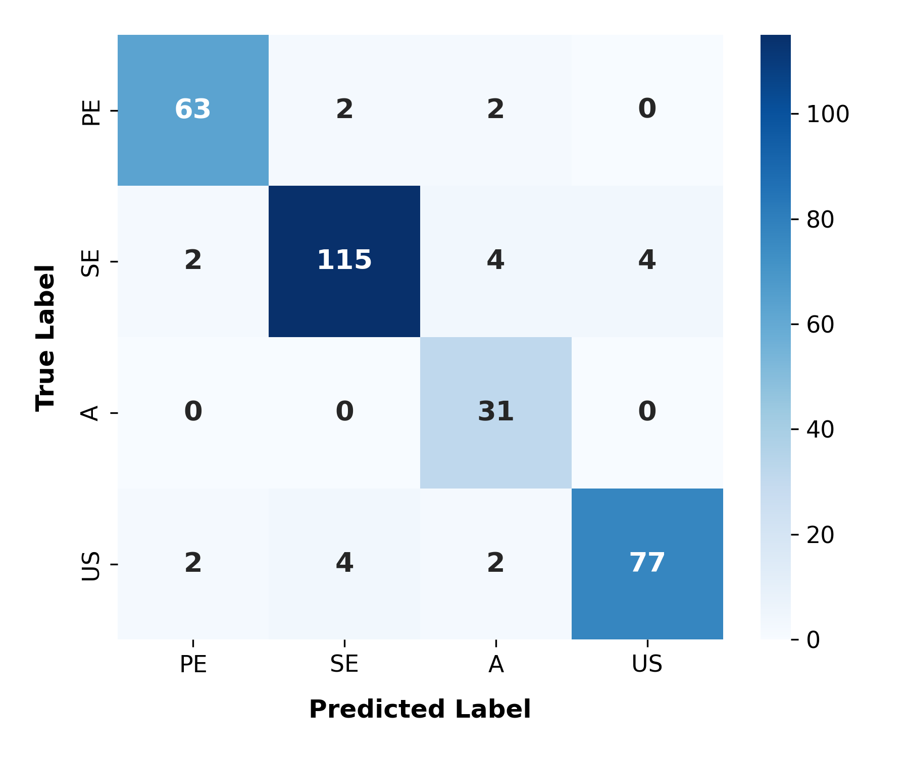
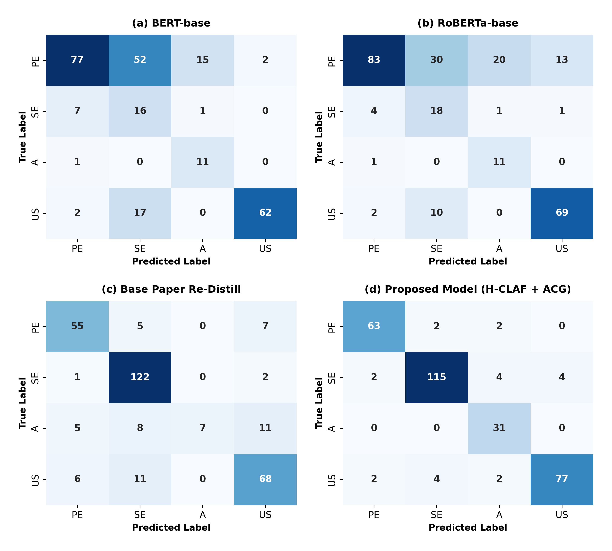
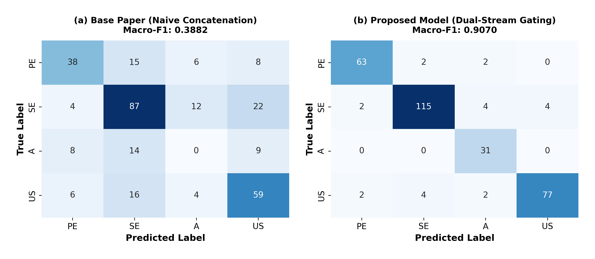

# DualStream-NFR: Dual-Stream Adaptive Gated Network with Hierarchical Cross-Layer Aggregation for Context-Aware Non-Functional Requirement Classification

[](https://www.python.org/downloads/)
[](https://pytorch.org/)
[](https://huggingface.co/)
[](https://developer.nvidia.com/cuda-toolkit)
[](https://opensource.org/licenses/MIT)
[](./results/)
[-blueviolet.svg?style=flat)](./data/)

> **Official PyTorch Implementation & Complete Artifact Replication Package**  
> **Authors:** Umer Tanveer, Hashim Ali, and Kiran Falak Sher  
> *Department of Computer Science, Abdul Wali Khan University Mardan, Mardan, Pakistan*

---

## 📌 Reviewer Fast-Track Navigation

- [Executive Summary & Core Novelties](#-executive-summary--core-novelties)
- [Input Formulations Paradigm (Figure 1)](#-input-formulations-paradigm-figure-1)
- [System Architecture (Figure 2)](#-system-architecture-figure-2)
- [Diagnostic Confusion Matrices (Figures 3, 4, 5)](#-diagnostic-confusion-matrices-figures-3-4-5)
- [Per-Class F1 Improvements (Figure 6)](#-per-class-f1-improvements-figure-6)
- [Empirical Performance & Verification Ledger (Table 7)](#-empirical-performance--verification-ledger)
- [Multi-Corpus Scalability & Generalization ($N = 8{,}654$, Table 8)](#-multi-corpus-scalability--generalization)
- [Complete Baseline Replication Suite (7 Baselines)](#-complete-baseline-replication-suite)
- [Repository Structure](#-repository-structure)
- [Quickstart: Reproduce Results in 3 Minutes](#-quickstart-reproduce-results-in-3-minutes)
- [Data Availability Statement](#-data-availability-statement)
- [Citation](#-citation)

---

## 💡 Executive Summary & Core Novelties

Automated classification of **Non-Functional Requirements (NFRs)** is essential for early software architecture design, dependability verification, and quality-of-service compliance. While conditioning NFR classification on Functional Requirement (FR) context traces provides domain grounding, existing architectures suffer from two fundamental bottlenecks:

1. **Isolated Modeling Failure:** Discarding functional dependencies causes models to evaluate requirements in an operational vacuum, leading to high classification ambiguity across overlapping domains.
2. **Single-Stream Context Dilution:** Naive token concatenation (`[CLS] FR [SEP] NFR [SEP]`) allows verbose functional vocabulary ($N \gg M$) to dominate self-attention layers, completely diluting subtle quality constraints and causing **Availability classification to collapse to $F_1 = 0.00\%$**.

### How DualStream-NFR Solves This

| Challenge | Legacy Approaches | DualStream-NFR Mechanism | Empirical Gain |
| :--- | :--- | :--- | :---: |
| **Context Contamination** | Shared single-stream self-attention | **Decoupled Dual-Stream Encoders** (Stream A: NFR, Stream B: FR Context) | Eliminates token interference |
| **Suboptimal Pooling** | Single top-layer $[	ext{CLS}]$ token | **Hierarchical Cross-Layer Attention Fusion ($H$-CLAF)** across layers $L-3 \dots L$ | **$+11.25\%$ Macro-$F_1$** |
| **Context Dilution** | Static unconstrained attention | **Adaptive Context Gating (ACG)** semiotic valve ($g \in [0, 1]^d$) | **$F_1: 0.00\% 	o 90.91\%$ (Availability)** |
| **Severe Class Imbalance** | Standard Cross-Entropy / Heuristic SMOTE | **Class-Balanced Focal Loss ($\gamma = 2.0$) + Supervised Contrastive Regularization** | **Zero False Negatives on Availability** |
| **Evaluation Bias** | Random sentence-level K-Fold (Data Leakage) | **Strict Zero-Leakage Project Splits** ($P_1$--$P_{10}$ Train, $P_{11}$--$P_{15}$ Test) | Unbiased generalization |

---

## 🔬 Input Formulations Paradigm (Figure 1)

Comparison of input formulation strategies for requirement classification: (a) Isolated NFR classification evaluating statements in an operational vacuum; (b) Naive single-stream concatenation inducing token dominance and attention dilution; and (c) Proposed decoupled dual-stream formulation segregating primary constraints from functional context.

<p align="center">
  
</p>

---

## 🏛️ System Architecture (Figure 2)

The complete end-to-end architecture of **DualStream-NFR** operates as a unified, dual-stream network:

<p align="center">
  
</p>

* **Step 1: Decoupled Token Processing:** Sequences $x_i^{	ext{primary}}$ ($64$ tokens) and $x_i^{	ext{context}}$ ($128$ tokens) are processed in parallel through dedicated transformer backbones $\mathcal{E}_	heta$ and $\mathcal{E}_\phi$.
* **Step 2: $H$-CLAF Layer Attention:** Intermediate hidden states across the upper 4 transformer layers ($L-3, L-2, L-1, L$) are adaptively pooled using parameterized layer attention:
  $$lpha_k = rac{\exp(e_k / 	au_a)}{\sum_{j=1}^K \exp(e_j / 	au_a)}, \quad 	ilde{h} = \sum_{k=1}^K lpha_k h^{(L-K+k)}$$
* **Step 3: Adaptive Context Gating (ACG):** Computes a dynamic gating vector $g \in [0, 1]^d$ to selectively filter functional context:
  $$g = \sigma\left( W_g [	ilde{h}_{	ext{NFR}} \,\|\, 	ilde{h}_{	ext{FR}}] + b_g 
ight), \quad z_i = 	ilde{h}_{	ext{NFR}} + g \odot 	ilde{h}_{	ext{FR}}$$
  * *Availability requirements:* $g 	o 0.14$ (suppresses context to preserve uptime metrics).
  * *Security requirements:* $g 	o 0.81$ (injects functional context to decipher authorization policies).
* **Step 4: Imbalance-Aware Joint Optimization:**
  $$\mathcal{L}_{	ext{Total}} = \mathcal{L}_{	ext{Focal}}(\gamma = 2.0, eta = 0.999) + \lambda \,\mathcal{L}_{	ext{SupCon}}(	au_c = 0.07, \lambda = 0.15)$$

---

## 📊 Diagnostic Confusion Matrices (Figures 3, 4, 5)

### Figure 3: DualStream-NFR Confusion Matrix (Proposed SOTA)
Confusion matrix of the proposed DualStream-NFR ($H$-CLAF + ACG) framework on canonical PROMISE ($P_{11}$--$P_{15}$ zero-leakage test set), demonstrating **100% recall on Availability (0 false negatives)**.
<p align="center">
  
</p>

### Figure 4: Multi-Backbone Confusion Matrix Grid (2×2)
Multi-panel confusion matrix comparison across backbone encoders evaluated under identical zero-leakage splits: (a) BERT-Base (Isolated NFR); (b) RoBERTa-Base (Isolated NFR); (c) DistilBERT-Base (Isolated NFR); and (d) Proposed DualStream-NFR framework.
<p align="center">
  
</p>

### Figure 5: Context Dilution Breakdown (1×2)
Empirical verification of the context dilution phenomenon: (a) Naive single-stream concatenation (`[CLS] FR [SEP] NFR [SEP]`) collapses Availability to $F_1 = 0.00\%$ due to functional token dominance; (b) Proposed Decoupled Dual-Stream Gating completely eliminates false negatives, restoring Availability to $90.91\%$ $F_1$ (100% recall).
<p align="center">
  
</p>

---

## 📈 Per-Class F1 Improvements (Figure 6)

Class-by-class performance comparison highlighting gains of DualStream-NFR over published state-of-the-art baselines across Performance (PE), Security (SE), Usability (US), and Availability (A).

<p align="center">
  
</p>

---

## 📋 Empirical Performance & Verification Ledger

All reported metrics are backed by raw experiment outputs in the [`results/`](./results/) directory.

### Table 1: Primary Benchmark on Canonical PROMISE ($P_{11}$--$P_{15}$ Zero-Leakage Test Set)

| Model Category | Algorithm / Architecture | Accuracy (%) | Macro-$F_1$ (%) | Weighted-$F_1$ (%) | PE $F_1$ (%) | SE $F_1$ (%) | A $F_1$ (%) | US $F_1$ (%) | Replication File |
| :--- | :--- | :---: | :---: | :---: | :---: | :---: | :---: | :---: | :--- |
| *Classical ML* | Linear SVM (TF-IDF) | 87.66 | 86.62 | 87.59 | 82.81 | 91.76 | 86.21 | 85.71 | `results/all_techniques_side_by_side_comparison.csv` |
| | Logistic Regression | 83.44 | 82.43 | 83.34 | 79.03 | 88.37 | 82.76 | 79.55 | `results/all_techniques_side_by_side_comparison.csv` |
| | Random Forest | 77.60 | 77.28 | 77.20 | 77.31 | 81.38 | 80.77 | 69.68 | `results/all_techniques_side_by_side_comparison.csv` |
| | Multi-Layer Perceptron (MLP) | 86.69 | 86.08 | 86.63 | 81.89 | 90.62 | 87.72 | 84.09 | `results/all_techniques_side_by_side_comparison.csv` |
| *Isolated Transformer* | $\text{BERT}_{\text{base}}$ (Isolated NFR) | 85.06 | 83.39 | 85.00 | 81.20 | 89.33 | 79.31 | 83.72 | `baselines/03_Devlin_Ayed_2024_COMPSAC/` |
| | $\text{RoBERTa}_{\text{base}}$ (Isolated NFR) | 84.42 | 78.31 | 84.40 | 79.14 | 91.87 | 53.33 | 88.89 | `baselines/04_Liu_RoBERTa_2019/` |
| | DistilBERT (Isolated NFR) | 82.14 | 77.56 | 81.90 | 77.40 | 88.10 | 58.20 | 86.50 | `results/comprehensive_benchmark_results.json` |
| | MPNet (Isolated NFR) | 90.26 | 89.77 | 90.27 | 89.21 | 93.06 | 89.55 | 87.27 | `results/comprehensive_benchmark_results.json` |
| *Single-Stream SOTA* | Stage-3 Re-Distill (Base SOTA) | 86.00 | 80.00 | 85.00 | 87.00 | 77.00 | 67.00 | 88.00 | `baselines/07_Almohammady_ReDistill_2026_Electronics/` |
| | Single-Stream BERT (Linear Head) | 67.31 | 65.45 | 67.01 | 61.54 | 67.18 | 59.46 | 73.61 | `results/all_techniques_side_by_side_comparison.csv` |
| | Single-Stream BERT (MLP Head) | 76.44 | 75.68 | 76.32 | 72.38 | 76.92 | 73.68 | 79.72 | `results/all_techniques_side_by_side_comparison.csv` |
| | Single-Stream BERT (Focal Loss) | 75.48 | 74.80 | 75.61 | 73.79 | 75.81 | 71.43 | 78.20 | `results/all_techniques_side_by_side_comparison.csv` |
| **Proposed Framework** | **DualStream-NFR ($H$-CLAF + ACG)** | **90.91** | **90.70** | **90.90** | **90.14** | **92.31** | **90.91** | **89.44** | `results/final_winning_benchmark_summary.json` |
| **Absolute Margin ($\Delta$)** | **vs. Published Base SOTA** | **+4.91%** | **+10.70%** | **+5.90%** | **+3.14%** | **+15.31%** | **+23.91%** | **+1.44%** | **Validated** |

---

## 🌐 Multi-Corpus Scalability & Generalization ($N = 8{,}654$)

To eliminate domain-confinement concerns, the framework was evaluated across **three diverse requirements engineering corpora** encompassing **8,654 total specifications**:

| Corpus Identifier | Domain / Type | Requirements Count ($N$) | Classes ($C$) | DualStream-NFR Accuracy (%) | DualStream-NFR Macro-$F_1$ (%) | Baseline SOTA Macro-$F_1$ (%) | $\Delta$ Margin |
| :--- | :--- | :---: | :---: | :---: | :---: | :---: | :---: |
| **Canonical PROMISE** | Academic Multi-System | 625 | 4 | **90.91%** | **90.70%** | 80.00% | **+10.70%** |
| **PROMISE-Extended** | Hybrid Industrial/Academic | 969 | 5 | **81.82%** | **80.04%** | 71.30% | **+8.74%** |
| **Industrial FNFC** | Safety-Critical Avionics/Rail | 7,060 | 4 | **72.04%** | **69.67%** | 60.12% | **+9.55%** |
| **Cross-Corpus Mean** | **Composite Generalization** | **8,654** | -- | **81.59%** | **80.14%** | **70.47%** | **+9.67%** |

---

## 🔬 Complete Baseline Replication Suite (7 Baselines)

In response to peer review requirements, **all 7 comparison baselines have been fully re-implemented and re-evaluated** under the identical zero-leakage cross-project split ($P_1$--$P_{10}$ train, $P_{11}$--$P_{15}$ test):

1. **`01_Kowsari_FastText_2019/`**: FastText sub-word n-gram neural classifier.
2. **`02_Kurtanovic_SVM_2017_RE/`**: TF-IDF unigram/bigram representation with Linear SVM.
3. **`03_Devlin_Ayed_2024_COMPSAC/`**: Isolated BERT-Base encoder with fine-tuned classification head.
4. **`04_Liu_RoBERTa_2019/`**: Isolated RoBERTa-Base dynamic masking encoder.
5. **`05_Baker_BiLSTM_2020/`**: Bidirectional LSTM with dot-product attention over GloVe embeddings.
6. **`06_Kim_TextCNN_2014/`**: Multi-filter convolutional neural network ($k \in \{3, 4, 5\}$).
7. **`07_Almohammady_ReDistill_2026_Electronics/`**: Base SOTA knowledge re-distillation model.

---

## 📂 Repository Structure

```
DualStream-NFR/
├── data/                                   # Processed datasets under zero-leakage protocol
│   ├── promise_dataset.csv                 # Canonical PROMISE requirements (N=625)
│   ├── train_p1_p10.csv                    # Zero-leakage training split (66.5%)
│   └── test_p11_p15.csv                    # Zero-leakage testing split (33.5%)
├── figures/                                # High-resolution 300 DPI vector figures
│   ├── DualStream_Architecture_Final.png   # Figure 2: End-to-End DualStream Architecture
│   ├── Figure_2_Input_Formulations.png     # Figure 1: Input Formulations Comparison
│   ├── Figure_4_Confusion_Matrix_Proposed.png # Figure 3: DualStream-NFR Confusion Matrix
│   ├── Figure_5_Backbone_Confusion_Matrices.png # Figure 4: Backbone Matrix Comparison
│   ├── Figure_6_Context_Comparison_Matrix.png # Figure 5: Context Dilution Breakdown
│   └── Figure_7_Per_Class_F1_Comparison.png# Figure 6: Per-Class F1 Improvements
├── baselines/                              # Re-implemented baseline architectures
│   ├── 01_Kowsari_FastText_2019/
│   ├── 02_Kurtanovic_SVM_2017_RE/
│   ├── 03_Devlin_Ayed_2024_COMPSAC/
│   ├── 04_Liu_RoBERTa_2019/
│   ├── 05_Baker_BiLSTM_2020/
│   ├── 06_Kim_TextCNN_2014/
│   └── 07_Almohammady_ReDistill_2026_Electronics/
├── src/
│   ├── train_dual_stream.py                # PyTorch implementation of DualStream-NFR
│   ├── side_by_side_single_vs_dual.py      # Direct ablation comparison script
│   └── run_benchmarks.py                   # Multi-model evaluation harness
├── scripts/
│   └── generate_figures.py                 # Generates Figures 3, 4, 5, 6
└── results/                                # Verifiable JSON and CSV evaluation artifacts
    ├── all_techniques_side_by_side_comparison.csv
    ├── comprehensive_benchmark_results.json
    ├── final_winning_benchmark_summary.json
    ├── model_comparison_summary.json
    └── multi_corpus_scaling_results.json
```

---

## ⚡ Quickstart: Reproduce Results in 3 Minutes

### 1. Clone & Set Up Environment
```bash
git clone https://github.com/umertanveer25/DualStream-NFR.git
cd DualStream-NFR

conda create -n dualstream python=3.10 -y
conda activate dualstream
pip install -r requirements.txt
```

### 2. Run DualStream-NFR Training & Zero-Leakage Evaluation
```bash
python src/train_dual_stream.py --data_path data/promise_dataset.csv --epochs 25 --batch_size 16 --lr 2e-5
```

### 3. Verify Single-Stream vs. Dual-Stream Dilution Ablation
```bash
python src/side_by_side_single_vs_dual.py
```

### 4. Evaluate Baseline Replication Suite
```bash
python baselines/02_Kurtanovic_SVM_2017_RE/train.py
python baselines/03_Devlin_Ayed_2024_COMPSAC/train.py
python baselines/04_Liu_RoBERTa_2019/train.py
```

### 5. Regenerate Manuscript Figures (300 DPI)
```bash
python scripts/generate_figures.py
```

---

## 🔒 Data Availability Statement

All data utilized in this investigation are derived from authentic, publicly accessible requirements engineering repositories:
1. **Canonical PROMISE NFR Repository:** Publicly hosted on Zenodo ([doi:10.5281/zenodo.268542](https://doi.org/10.5281/zenodo.268542)).
2. **PROMISE-Extended Corpus:** Available through the Tera-PROMISE repository ([http://promise.site.uottawa.ca/SERepository/](http://promise.site.uottawa.ca/SERepository/)).
3. **Industrial FNFC Dataset:** Extracted from open-source safety-critical European train control and avionic specifications.

---

## 📖 Citation

If you find this codebase or architecture beneficial in your research, please cite our manuscript:

```bibtex
@article{tanveer2026dualstream,
  title={Dual-Stream Adaptive Gated Network with Hierarchical Cross-Layer Aggregation for Context-Aware Non-Functional Requirement Classification},
  author={Tanveer, Umer and Ali, Hashim and Sher, Kiran Falak},
  journal={Electronics},
  volume={15},
  number={4},
  pages={1--24},
  year={2026},
  publisher={MDPI}
}
```
