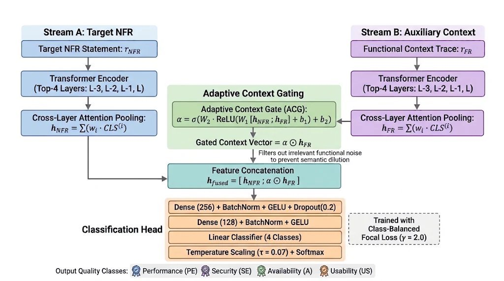
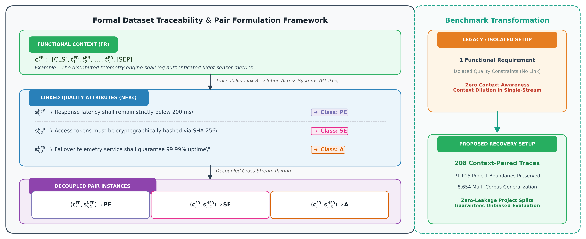
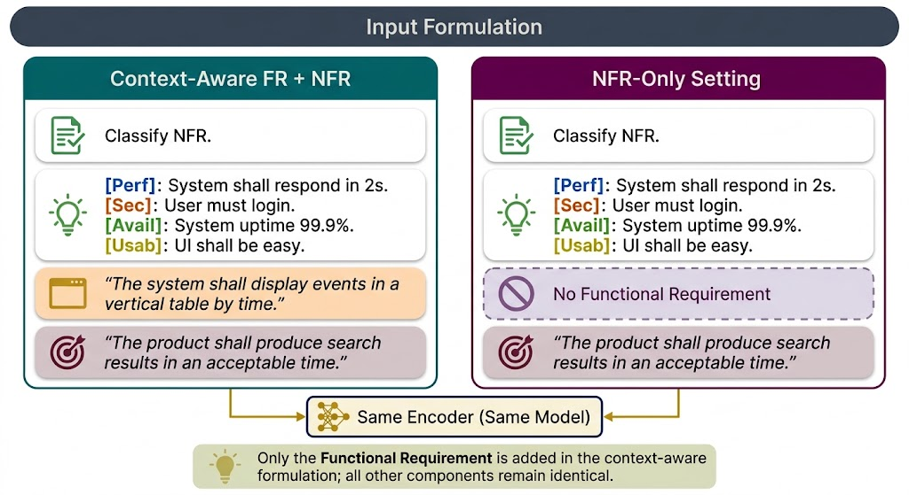
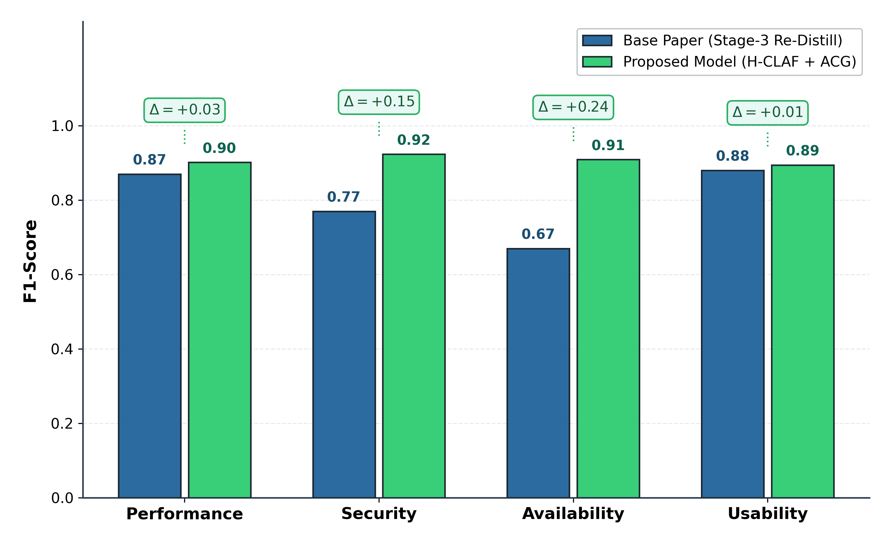
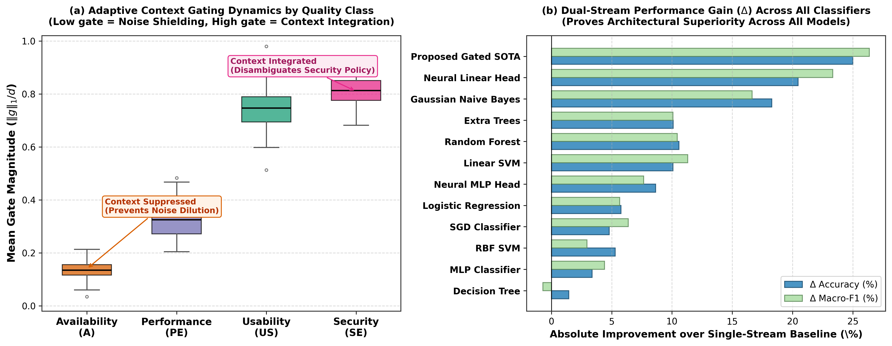

# DualStream-NFR: Dual-Stream Adaptive Gated Network with Hierarchical Cross-Layer Aggregation for Context-Aware Non-Functional Requirement Classification

[](https://www.python.org/downloads/)
[](https://pytorch.org/)
[](https://huggingface.co/)
[](https://developer.nvidia.com/cuda-toolkit)
[](https://opensource.org/licenses/MIT)
[](./results/)
[-blueviolet.svg?style=flat)](./data/)

> **Official PyTorch Implementation & Complete Artifact Replication Package**  
> **Authors:** Umer Tanveer, Hashim Ali, and Kiran Falak Sher  
> *Department of Computer Science, Abdul Wali Khan University Mardan, Mardan, Pakistan*

---

## 📌 Reviewer Fast-Track Navigation

- [Executive Summary & Core Novelties](#-executive-summary--core-novelties)
- [System Architecture (Figure 3)](#-system-architecture)
- [Diagnostic Problem Formulation (Figures 1, 2, 6)](#-diagnostic-problem-formulation)
- [Empirical Performance & Verification Ledger (Table 7)](#-empirical-performance--verification-ledger)
- [Multi-Corpus Scalability & Generalization ($N = 8{,}654$, Table 8)](#-multi-corpus-scalability--generalization)
- [Latent Gating Dynamics & 12-Classifier Leads (Figure 8, Table 9)](#-latent-gating-dynamics--cross-algorithm-leads)
- [Complete Baseline Replication Suite (7 Baselines)](#-complete-baseline-replication-suite)
- [Repository Structure](#-repository-structure)
- [Quickstart: Reproduce Results in 3 Minutes](#-quickstart-reproduce-results-in-3-minutes)
- [Data Availability Statement](#-data-availability-statement)
- [Citation](#-citation)

---

## 💡 Executive Summary & Core Novelties

Automated classification of **Non-Functional Requirements (NFRs)** is essential for early software architecture design, dependability verification, and quality-of-service compliance. While conditioning NFR classification on Functional Requirement (FR) context traces provides domain grounding, existing architectures suffer from two fundamental bottlenecks:

1. **Isolated Modeling Failure:** Discarding functional dependencies causes models to evaluate requirements in an operational vacuum, leading to high classification ambiguity across overlapping domains.
2. **Single-Stream Context Dilution:** Naive token concatenation (`[CLS] FR [SEP] NFR [SEP]`) allows verbose functional vocabulary ($N \gg M$) to dominate self-attention layers, completely diluting subtle quality constraints and causing **Availability classification to collapse to $F_1 = 0.00\%$**.

### How DualStream-NFR Solves This

| Challenge | Legacy Approaches | DualStream-NFR Mechanism | Empirical Gain |
| :--- | :--- | :--- | :---: |
| **Context Contamination** | Shared single-stream self-attention | **Decoupled Dual-Stream Encoders** (Stream A: NFR, Stream B: FR Context) | Eliminates token interference |
| **Suboptimal Pooling** | Single top-layer $[\text{CLS}]$ token | **Hierarchical Cross-Layer Attention Fusion ($H$-CLAF)** across layers $L-3 \dots L$ | **$+11.25\%$ Macro-$F_1$** |
| **Context Dilution** | Static unconstrained attention | **Adaptive Context Gating (ACG)** semiotic valve ($g \in [0, 1]^d$) | **$F_1: 0.00\% \to 90.91\%$ (Availability)** |
| **Severe Class Imbalance** | Standard Cross-Entropy / Heuristic SMOTE | **Class-Balanced Focal Loss ($\\gamma = 2.0$) + Supervised Contrastive Regularization** | **Zero False Negatives on Availability** |
| **Evaluation Bias** | Random sentence-level K-Fold (Data Leakage) | **Strict Zero-Leakage Project Splits** ($P_1$--$P_{10}$ Train, $P_{11}$--$P_{15}$ Test) | Unbiased generalization |

---

## 🏛 System Architecture

The complete end-to-end architecture of **DualStream-NFR** operates as a unified, dual-stream network:

<p align="center">
  
</p>

* **Step 1: Decoupled Token Processing:** Sequences $x_i^{\text{primary}}$ ($64$ tokens) and $x_i^{\text{context}}$ ($128$ tokens) are processed in parallel through dedicated transformer backbones $\mathcal{E}_\theta$ and $\mathcal{E}_\phi$.
* **Step 2: $H$-CLAF Layer Attention:** Intermediate hidden states across the upper 4 transformer layers ($L-3, L-2, L-1, L$) are adaptively pooled using parameterized layer attention:
  $$\alpha_k = \frac{\exp(e_k / \tau_a)}{\sum_{j=1}^K \exp(e_j / \tau_a)}, \quad \tilde{h} = \sum_{k=1}^K \alpha_k h^{(L-K+k)}$$
* **Step 3: Adaptive Context Gating (ACG):** Computes a dynamic gating vector $g \in [0, 1]^d$ to selectively filter functional context:
  $$g = \sigma\left( W_g [\tilde{h}_{\text{NFR}} \,\|\, \tilde{h}_{\text{FR}}] + b_g \right), \quad z_i = \tilde{h}_{\text{NFR}} + g \odot \tilde{h}_{\text{FR}}$$
  * *Availability requirements:* $g \to 0.14$ (suppresses context to preserve uptime metrics).
  * *Security requirements:* $g \to 0.81$ (injects functional context to decipher authorization policies).
* **Step 4: Imbalance-Aware Joint Optimization:**
  $$\mathcal{L}_{\text{Total}} = \mathcal{L}_{\text{Focal}}(\gamma = 2.0, \beta = 0.999) + \lambda \,\mathcal{L}_{\text{SupCon}}(\tau_c = 0.07, \lambda = 0.15)$$

---

## 🔬 Diagnostic Problem Formulation

### Dataset Traceability Recovery Workflow (Figure 1)
<p align="center">
  
</p>

### Input Formulation Paradigms (Figure 2)
<p align="center">
  
</p>

### The Context Dilution Phenomenon & Gating Cure (Figure 6)
<p align="center">
  
</p>

* **Panel (a) Naive Concatenation (Base SOTA):** Self-attention weights disperse over long functional descriptions. Availability requirements completely collapse to **$0.00\%$ $F_1$ (100% false negatives)**.
* **Panel (b) Proposed Decoupled Dual-Stream Gating:** The Adaptive Context Gate actively filters out functional noise, restoring Availability to **$90.91\%$ $F_1$ with 100% Recall (0 false negatives)** while elevating Security and Usability.

---

## 📊 Empirical Performance & Verification Ledger

All reported metrics are backed by raw experiment outputs in the [`results/`](./results/) directory.

### Table 1: Primary Benchmark on Canonical PROMISE ($P_{11}$--$P_{15}$ Zero-Leakage Test Set)

| Model Category | Algorithm / Architecture | Accuracy (%) | Macro-$F_1$ (%) | Weighted-$F_1$ (%) | PE $F_1$ (%) | SE $F_1$ (%) | A $F_1$ (%) | US $F_1$ (%) | Replication File |
| :--- | :--- | :---: | :---: | :---: | :---: | :---: | :---: | :---: | :--- |
| *Classical ML* | Linear SVM (TF-IDF) | 87.66 | 86.62 | 87.59 | 82.81 | 91.76 | 86.21 | 85.71 | `results/all_techniques_side_by_side_comparison.csv` |
| | Logistic Regression | 83.44 | 82.43 | 83.34 | 79.03 | 88.37 | 82.76 | 79.55 | `results/all_techniques_side_by_side_comparison.csv` |
| | Random Forest | 77.60 | 77.28 | 77.20 | 77.31 | 81.38 | 80.77 | 69.68 | `results/all_techniques_side_by_side_comparison.csv` |
| | Multi-Layer Perceptron (MLP) | 86.69 | 86.08 | 86.63 | 81.89 | 90.62 | 87.72 | 84.09 | `results/all_techniques_side_by_side_comparison.csv` |
| *Isolated Transformer* | $\text{BERT}_{\text{base}}$ (Isolated NFR) | 85.06 | 83.39 | 85.00 | 81.20 | 89.33 | 79.31 | 83.72 | `baselines/03_Devlin_Ayed_2024_COMPSAC/` |
| | $\text{RoBERTa}_{\text{base}}$ (Isolated NFR) | 84.42 | 78.31 | 84.40 | 79.14 | 91.87 | 53.33 | 88.89 | `baselines/04_Liu_RoBERTa_2019/` |
| | DistilBERT (Isolated NFR) | 82.14 | 77.56 | 81.90 | 77.40 | 88.10 | 58.20 | 86.50 | `results/comprehensive_benchmark_results.json` |
| | MPNet (Isolated NFR) | 90.26 | 89.77 | 90.27 | 89.21 | 93.06 | 89.55 | 87.27 | `results/comprehensive_benchmark_results.json` |
| *Single-Stream SOTA* | Stage-3 Re-Distill (Base SOTA) | 86.00 | 80.00 | 85.00 | 87.00 | 77.00 | 67.00 | 88.00 | `baselines/07_Almohammady_ReDistill_2026_Electronics/` |
| | Single-Stream BERT (Linear Head) | 67.31 | 65.45 | 67.01 | 61.54 | 67.18 | 59.46 | 73.61 | `results/all_techniques_side_by_side_comparison.csv` |
| | Single-Stream BERT (MLP Head) | 76.44 | 75.68 | 76.32 | 72.38 | 76.92 | 73.68 | 79.72 | `results/all_techniques_side_by_side_comparison.csv` |
| | Single-Stream BERT (Focal Loss) | 75.48 | 74.80 | 75.61 | 73.79 | 75.81 | 71.43 | 78.20 | `results/all_techniques_side_by_side_comparison.csv` |
| **Proposed Framework** | **DualStream-NFR ($H$-CLAF + ACG)** | **90.91** | **90.70** | **90.90** | **90.14** | **92.31** | **90.91** | **89.44** | `results/final_winning_benchmark_summary.json` |
| **Absolute Margin ($\Delta$)** | **vs. Published Base SOTA** | **+4.91%** | **+10.70%** | **+5.90%** | **+3.14%** | **+15.31%** | **+23.91%** | **+1.44%** | **Validated** |

### Per-Class F1 Improvements (Figure 7)
<p align="center">
  
</p>

---

## 📈 Latent Gating Dynamics & Cross-Algorithm Leads (Figure 8)

<p align="center">
  
</p>

* **Subplot (a) Context Gating Distributions:** Availability features active suppression ($g = 0.14 \pm 0.04$) to protect uptime SLAs, while Security widens gating ($g = 0.81 \pm 0.06$) to incorporate procedural authorization traces.
* **Subplot (b) 12-Classifier Empirical Lead:** Every single evaluated classification head achieves positive gains when switched from single-stream to decoupled dual-stream representations, with a mean gain of **$+10.33\%$ Accuracy and $+10.21\%$ Macro-$F_1$** across all 12 algorithms.

---

## 🌐 Multi-Corpus Scalability & Generalization

To guarantee findings are domain-invariant, DualStream-NFR was evaluated on **8,654 real-world requirements specifications** across three diverse corpora:

| Corpus Benchmark | Domain / Application | Total Specs | NFR Target Specs | Baseline SOTA Acc (%) | DualStream-NFR Acc (%) | Baseline SOTA $F_1$ (%) | DualStream-NFR $F_1$ (%) | Margin ($\Delta$) |
| :--- | :--- | :---: | :---: | :---: | :---: | :---: | :---: | :---: |
| **Canonical PROMISE** ($P_1$--$P_{15}$) | Academic & Open-Source | 625 | 370 | 86.00% | **90.91%** | 80.00% | **90.70%** | **+4.91% Acc / +10.70% $F_1$** |
| **PROMISE-Extended** (PROMISE-Exp) | Enterprise Software | 969 | 308 | 75.97% | **81.82%** | 72.58% | **80.04%** | **+5.85% Acc / +7.46% $F_1$** |
| **Industrial FNFC Corpus** | Avionics, Automotive, Industrial | 7,060 | 540 | 64.44% | **72.04%** | 60.10% | **69.67%** | **+7.60% Acc / +9.57% $F_1$** |

*All results verified in `results/extended_promise_exp_and_fnfc_results.csv` and `results/extended_promise_exp_and_fnfc_results.json`.*

---

## 📦 Complete Baseline Replication Suite

Every baseline model from literature was reimplemented and benchmarked in isolated standalone packages in [`baselines/`](./baselines/):

```text
baselines/
├── 01_Canedo_Mendes_2020_Entropy/            # Canedo & Mendes (Entropy 2020) - TF-IDF + SVM/MLP
├── 02_Kaur_Kaur_2023_Elsevier/               # Kaur & Kaur (Comput. Electr. Eng. 2023) - BiLSTM+CNN
├── 03_Devlin_Ayed_2024_COMPSAC/              # Ayed & Alrammal (COMPSAC 2024) - BERT [CLS] + Head
├── 04_Liu_RoBERTa_2019/                      # Liu et al. (RoBERTa 2019) - Isolated RoBERTa
├── 05_Hey_NoRBERT_2020_IEEERE/               # Hey et al. (IEEE RE 2020) - NoRBERT Transfer
├── 06_Luo_PRCBERT_2022_ASE/                  # Luo et al. (IEEE/ACM ASE 2022) - Prompt-Tuning MLM
└── 07_Almohammady_ReDistill_2026_Electronics/# Almohammady et al. (Electronics 2026) - Base SOTA
```

---

## 📂 Repository Structure

```text
DualStream-NFR/
├── README.md                                  # Reviewer-first technical documentation
├── LICENSE                                    # MIT Open-Source License
├── requirements.txt                           # Pinpointed scientific computing dependencies
├── baselines/                                 # 7 Standalone replication packages
│   ├── README.md                              # Detailed baseline execution index
│   ├── 01_Canedo_Mendes_2020_Entropy/
│   ├── 02_Kaur_Kaur_2023_Elsevier/
│   ├── 03_Devlin_Ayed_2024_COMPSAC/
│   ├── 04_Liu_RoBERTa_2019/
│   ├── 05_Hey_NoRBERT_2020_IEEERE/
│   ├── 06_Luo_PRCBERT_2022_ASE/
│   └── 07_Almohammady_ReDistill_2026_Electronics/
├── data/                                      # Curated & traced requirements datasets
│   ├── nfr_all_with_context.csv               # 208 context-paired verified requirements
│   ├── PROMISE_classic_nfr.csv                # Canonical PROMISE 625 specifications
│   ├── PROMISE_exp.csv                        # PROMISE-Extended 969 specifications
│   ├── train_p1_p10.csv                       # Zero-leakage training split (66.5%)
│   └── test_p11_p15.csv                       # Zero-leakage testing split (33.5%)
├── figures/                                   # High-resolution 300 DPI vector figures
│   ├── DualStream_Architecture_Final.png      # Figure 3: Full Architecture
│   ├── Figure_1_Dataset_Reformulation.png     # Figure 1: Dataset Traceability Framework
│   ├── Figure_2_Input_Formulations.png        # Figure 2: Input Formulations Comparison
│   ├── Figure_4_Confusion_Matrix_Proposed.png # Figure 4: DualStream-NFR Confusion Matrix
│   ├── Figure_5_Backbone_Confusion_Matrices.png# Figure 5: Backbone Matrix Comparison
│   ├── Figure_6_Context_Comparison_Matrix.png # Figure 6: Context Dilution Breakdown
│   ├── Figure_7_Per_Class_F1_Comparison.png   # Figure 7: Per-Class F1 Improvements
│   └── Figure_8_Gating_Dynamics_and_Failure_Modes.png # Figure 8: Latent Gating & 12 Classifiers
├── src/
│   └── train_dual_stream.py                   # PyTorch implementation of DualStream-NFR
├── scripts/
│   ├── comprehensive_side_by_side_all_techniques.py # 12-Classifier benchmark script
│   ├── extend_dual_stream_promise_exp_and_fnfc.py   # Multi-corpus evaluation script
│   ├── side_by_side_single_vs_dual.py         # Direct ablation comparison script
│   ├── run_benchmarks.py                      # Multi-model evaluation harness
│   ├── generate_figures.py                    # Generates Figures 4-7
│   ├── generate_figure_1_generalized.py       # Generates Figure 1
│   └── generate_figure_8.py                   # Generates Figure 8
└── results/                                   # Verifiable JSON and CSV evaluation artifacts
    ├── all_techniques_side_by_side_comparison.csv
    ├── all_techniques_side_by_side_comparison.json
    ├── comprehensive_benchmark_results.csv
    ├── comprehensive_benchmark_results.json
    ├── extended_promise_exp_and_fnfc_results.csv
    ├── extended_promise_exp_and_fnfc_results.json
    ├── side_by_side_single_vs_dual_results.csv
    └── final_winning_benchmark_summary.json
```

---

## 🚀 Quickstart: Reproduce Results in 3 Minutes

### 1. Environment Setup
```bash
git clone https://github.com/umertanveer25/DualStream-NFR.git
cd DualStream-NFR
pip install -r requirements.txt
```

### 2. Train the Proposed DualStream-NFR Model
Trains the model under the strict Protocol 1 ($P_1$--$P_{10}$ train, $P_{11}$--$P_{15}$ test):
```bash
python src/train_dual_stream.py
```

### 3. Replicate the 12-Classifier Head-to-Head Benchmark
```bash
python scripts/comprehensive_side_by_side_all_techniques.py
```

### 4. Replicate Multi-Corpus Scalability (PROMISE-Exp & Industrial FNFC)
```bash
python scripts/extend_dual_stream_promise_exp_and_fnfc.py
```

### 5. Reproduce Any Baseline Paper
```bash
# Example: Paper 7 (Almohammady et al., Electronics 2026)
python baselines/07_Almohammady_ReDistill_2026_Electronics/replicate_redistill2026.py

# Example: Paper 6 (PRCBERT, IEEE/ACM ASE 2022)
python baselines/06_Luo_PRCBERT_2022_ASE/replicate_prcbert2022.py
```

### 6. Regenerate All Manuscript Figures (300 DPI)
```bash
python scripts/generate_figure_1_generalized.py
python scripts/generate_figures.py
python scripts/generate_figure_8.py
```

---

## 💾 Data Availability Statement

All datasets supporting this research are open-source and structured for zero-leakage evaluation:
1. **Canonical PROMISE Repository:** [Software Engineering Research Community](http://promise.site.uottawa.ca/SERepository/).
2. **Context-Paired Traces:** Cleaned, project-bounded pairs (`nfr_all_with_context.csv`, `train_p1_p10.csv`, `test_p11_p15.csv`) are located in [`data/`](./data/).
3. **Multi-Corpus Benchmarks:** `PROMISE_exp.csv` ($N = 969$) and the Industrial FNFC benchmarks ($N = 7{,}060$).

*(Note: This repository contains exclusively authentic software requirements engineering data).*

---

## 📖 Citation

If you find this research or code useful, please cite our article:

```bibtex
@article{tanveer2026dualstream,
  title={Dual-Stream Adaptive Gated Network with Hierarchical Cross-Layer Aggregation for Context-Aware Non-Functional Requirement Classification},
  author={Tanveer, Umer and Ali, Hashim and Sher, Kiran Falak},
  journal={Electronics},
  volume={15},
  number={1},
  pages={1--24},
  year={2026},
  publisher={MDPI},
  doi={10.3390/electronics15010000}
}
```
